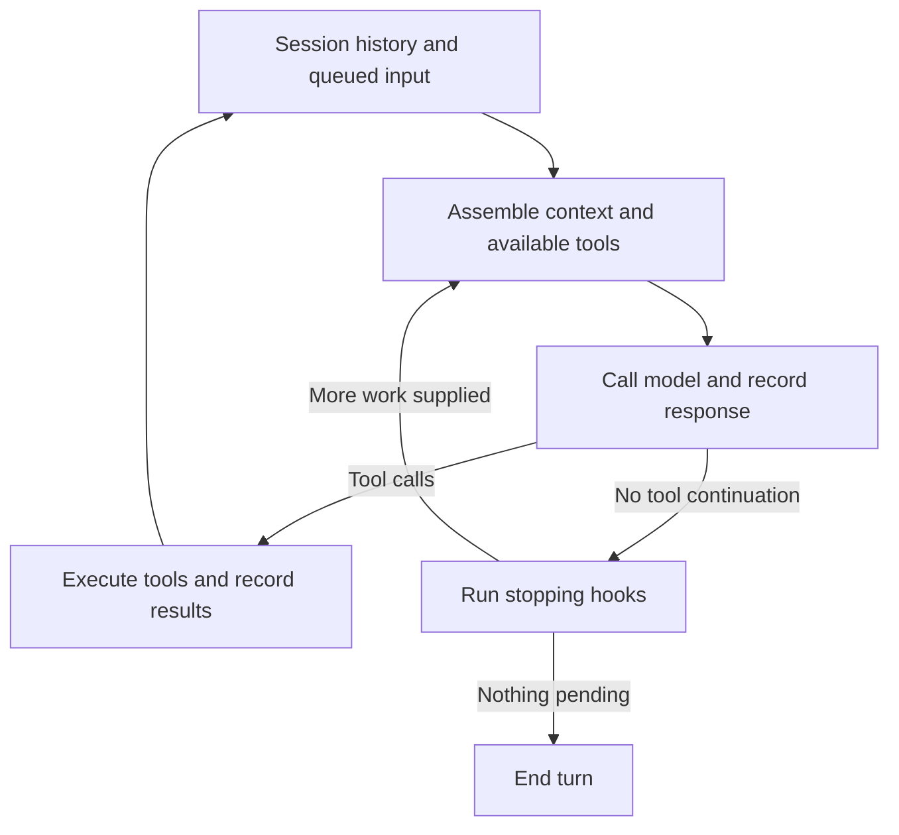

**Found it: [DeepSeek Harness (`dsh`)](https://github.com/deepseek-ai/deepseek-harness). The latest listed release is v0.2.0-rc.2, released September 29.** It remains a developer preview. :chatgpt-content-reference{index="0"}

Its main design choice is useful for us: **the model adapter, tools, memory handling, and agent loop are replaceable plugins.** We can change how an agent works while keeping the same surrounding system. :chatgpt-content-reference{index="1"}

**Here is how its ordinary loop works:**

Each model call plus its tool executions is a **step**. Multiple steps form a **turn**. Tool results return to the history, so the next call sees what actually happened. Hooks can intervene before a step, around tool execution, and before stopping. :chatgpt-content-reference{index="2"}

There is also an **outer loop for continuing toward a goal**. When the agent becomes idle, the goal driver checks whether the goal remains active, continuation is enabled, and rounds remain. If so, it queues another instruction toward that same objective, in the same session. Completion, blocking, cancellation, or the round limit stops continuation. :chatgpt-content-reference{index="3"}

Two details matter for your previous failures:

- **History survives context shortening.** Compaction changes the condensed history shown to the model while recording the summary and the events it replaced. This lets working context shrink without treating the summary as the entire historical record. :chatgpt-content-reference{index="4"}
- **Recorded and safely saved are separate states.** Its persistence interface has an explicit `flush()` checkpoint that guarantees acknowledged records survive a crash. Recovery marks interrupted work as interrupted. :chatgpt-content-reference{index="5"}

**The missing piece for ACC: its goal driver explicitly has no independent evaluator.** The model-facing policy decides whether completion evidence is sufficient. Also, its round limit does not enforce time, token, or money budgets. Those require separate controls. :chatgpt-content-reference{index="6"}

My proposed combination would be:

| Part | Our assignment |
|---|---|
| Execute experiments and respond to results | **Sol**, inside the working loop |
| Retrieve relevant failures and unfinished attempts | **Luna**, before selected steps |
| Diagnose repeated failure or challenge a completion claim | **Astra**, called through explicit review triggers |
| Decide whether an ACC route is valid and scoring | **Exact checker and current eligibility checks** |
| Continue, wait, change direction, or stop | **Code**, using those recorded outcomes |

The extension points support that architecture; the particular model allocation is our proposal. Exact Sol/Astra/Luna connectivity still needs checking against the chosen adapters. :chatgpt-content-reference{index="7"}

**The fresh addition I’d make is a condition for reopening every unsuccessful attempt:** record what failed, what evidence would justify trying again, and which agent should receive it. Then new evidence can wake the right investigation. That is the part we should build and test beyond the standard repeat-until-done loop.
